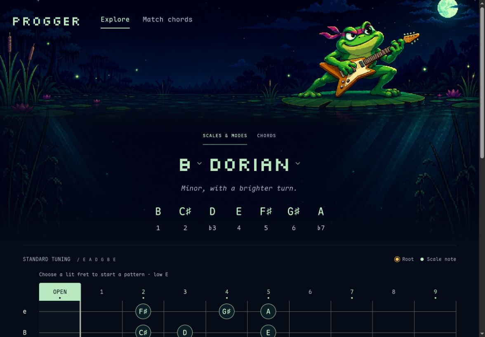
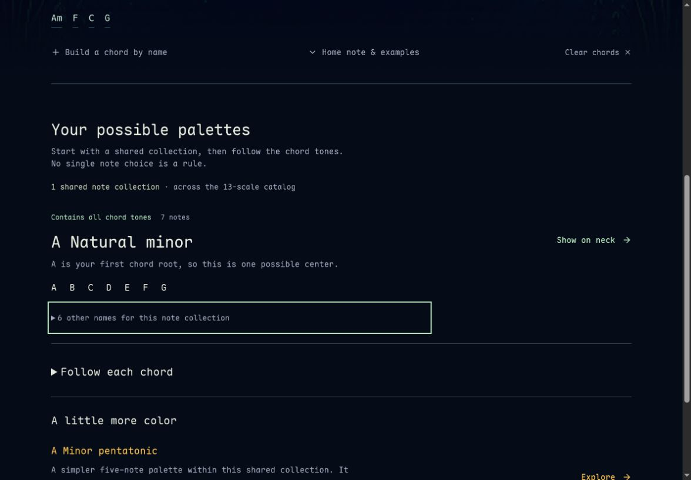
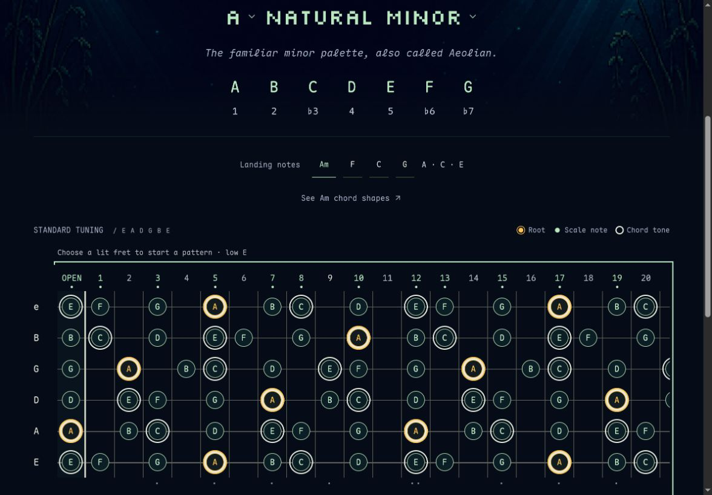

# Progger: from reference to practice

September 7, 2026. Product review and proposed direction; no application changes.

## Scope and evidence

Current local browser flow: B Dorian reference → Match Am F C G → A natural minor on the neck. Three current-run screenshots were saved and inspected. Source inspection and independent music, UX, and implementation critiques supplement those captures. This is a targeted workflow review, not a new exhaustive regression or accessibility audit. Proposals are hypotheses, not findings from user research.

1. **Explore — strong visual identity, useful reference.** The Night Swim scene and shared typography make the tool recognizable. Notes, degrees and pattern entry are present. At the captured viewport the full neck is below the fold; a future compact practice presentation should be optional and retain the scene on entry. “Minor, with a brighter turn” describes a sound the user cannot currently audition.

2. **Match — clear, honest analysis; next action could be more practical.** Am F C G produces one shared collection, qualified tonal interpretation and collapsed alternatives. This avoids overwhelming the initial result. “Show on neck” explains the destination but does not yet choose a playable starting exercise.

3. **Match to neck — context survives; player still does the coordination.** The progression and manually selectable landing notes appear above the neck. The result opens Full neck, confirmed in browser accessibility state and openMatch source. Many visible note targets are useful for reference, but a beginner still chooses a position and switches chords by hand while playing.

## Proposed signature experience

Enter a progression, choose a comfortable neck area, and press Play. Hear the progression while the existing neck follows the current chord. Show a few useful landing targets and keep broader scale notes available. Give the player something understandable to try within a minute.

First slice: Am F C G, one suggested valid practice pattern, explicit one-bar-per-chord 4/4 playback, tempo and Play/Stop. Start on user action. Use intentionally voiced rooted accompaniment; separately audition an exact displayed shape from its actual pitches. Rootless shape playback must not silently add missing roots. An optional bass accompaniment must be labelled. Keep timing visually and audibly aligned. Mobile audio interruptions and stop behavior require device verification.

Subsequent depth:

- **Hear this sound:** exact selected voicing playback; scale or characteristic-note comparison over an explicit tonic drone. Audition must respect actual register, string pitches and omissions.
- **Keep my hand here:** a few nearby next-chord grips, with common notes and changed notes shown on the same neck. Let players compare alternatives. Small pitch distance is not proof of comfortable fingering; assess fret movement, stretches, string sets, and real playing.
- **Pick up where I left off:** remember the local session and offer a reproducible link containing progression, scale, position and selected voicing. Validate restored state against a versioned schema.
- **Small teaching moments:** one optional cue tied to the present musical choice. Avoid treating all extensions as equally settled targets or implying one correct scale.

Keep the frog and pond as the visual signature. A quiet pulse or ripple on a chord change could reinforce feedback; no animation over fret labels, and respect reduced motion. Avoid a third dashboard, persistent tutorial, points system or elaborate transport panel.

## Concrete musical coverage gap

Independent reviewer probes were repeated directly against the current deterministic engine:

| Input | Current exact collections | Same-root per-chord choices |
| --- | --- | --- |
| C7#9 | None | None |
| C7#11 | G jazz melodic minor | None |
| C9#11 | G jazz melodic minor | None |
| C7b9 | F harmonic minor | None |

The advanced chord catalog now exceeds the scale vocabulary. Prioritize reviewed melodic/harmonic-minor modes and symmetric scales where they close these specific tasks. Exact coverage must remain distinct from stylistic suggestions: C altered does not contain the G natural in the full C7#9 formula. These are catalog limits, not evidence that no musical choice exists.

## Review challenges and decisions

The music reviewer favored exact audition and nearby voicing movement. The UX reviewer put a playable first result and durable sessions first. The implementation reviewer argued that isolated note audition would be less compelling than playback synchronized with the player's own progression. Synthesis: build one small progression-to-practice journey, then extend it using the existing chord and neck model. Treat comfortable voicing transitions as a separate reviewed follow-up rather than claiming a simple distance algorithm solves playability.

Defer AI Progression Lab, broad additional chord catalogs and elaborate backing-track controls. Alternate tunings remain a meaningful guitar-specific follow-up, but must regenerate and validate diagrams and patterns rather than relabel standard-tuning shapes.

## Accessibility and validation limits

Visible focus outlines and textual note/degree labels are present in the captures. Small muted annotations and dense full-map targets remain areas for contrast, zoom and touch verification. This run did not test screen-reader interaction, mobile reflow, measured contrast or audio accessibility. Existing checks are not recast as new evidence.

Validate the direction with guitarists of differing experience: give them their own four chords, ask them to find something to play, and observe whether they start playing without explanation. Watch where they stop, whether the suggested position is comfortable, and whether they can distinguish the current chord's targets by ear. A useful success criterion is reaching an understandable phrase in about a minute; that is a proposed target, not an achieved result.
